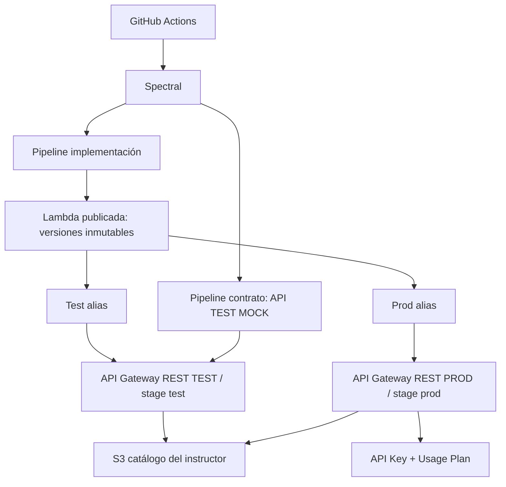
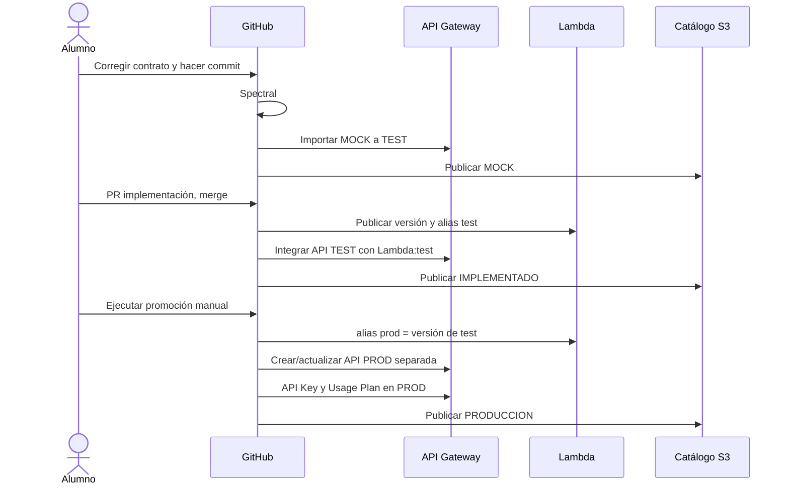

# Arquitectura del laboratorio

El entorno PROD es **simulado con fines docentes**.

## Decisión importante

Se usan **dos REST APIs** independientes para impedir que `apiKeyRequired` afecte TEST. La integración de TEST usa `Lambda:test` y PROD `Lambda:prod`. Es una decisión de simplicidad y aislamiento didáctico, no la única topología empresarial posible.

## Flujo de gobernanza

## Alcance de seguridad

API Key **no autentica personas ni sustituye IAM/JWT**. Solo identifica consumidores para controles como cuotas. El catálogo S3 website se sirve por HTTP y puede ser público: no almacenar datos reales, secretos ni documentos internos.
